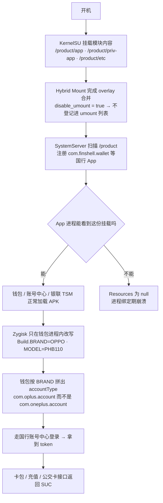

# WalletFix4OOS

让 **OxygenOS 16** 的一加 11（CPH2449）直接使用**国行一加钱包**：卡包、公交卡、门禁卡、钱包账号登录都能用。

> 上游项目：[geniucker-dev/WalletFix4OOS](https://github.com/geniucker-dev/WalletFix4OOS) `2.3.0`（1064）
> 本仓库是它的 **PHB110 / OxygenOS 16 适配分支**；国行组件取自 PHB110 ColorOS 16.0.5.701(CN01) 全量包。
> 适配、排障与文档由 **ChatGPT 与 DeepSeek** 完成，沿用上游 GPL 许可。

## 适用环境

| 项 | 要求 |
| --- | --- |
| 机型 | 一加 11 `CPH2449`（模块会校验 `ro.product.model`） |
| 系统 | OxygenOS 16 / Android 16 |
| Root | KernelSU（已测 3.3.1）+ Zygisk Next |
| 挂载 | Hybrid Mount（让模块的 `/product` 覆盖生效） |

## 原理



三条关键点：

1. **搬组件**：把国行 `FinShellWallet`、`KeKeUserCenterAccount`（`com.oplus.account`）、`OpenID`、`UPTsmService` 等作为普通 product 系统 App 挂进去。
2. **别动 OEM 账号 App**：`/product/priv-app/KeKeUserCenter` 是 `com.oneplus.account`，用国行 `com.heytap.vip` 壳覆盖它会让账号中心 `Resources$NotFoundException` 崩溃，钱包跟着被 provider 拖死。本模块**不覆盖**该目录。
3. **保留 root 隐藏**：`kernel_umount` 保持开启（App 默认看不到模块挂载），只让本模块的挂载点豁免——`disable_umount = true` + `service.sh` 里对 4 个挂载点 `ksud kernel umount del`。

## 安装

1. KernelSU 里刷入 `WalletFix4OOS-PHB110.zip`。
2. **重启**（Hybrid Mount 的 overlay 是开机快照，不重启不生效）。
3. 桌面/抽屉里找到「钱包」，用国内一加/OPPO 账号登录。

卸载：KernelSU 里移除模块 → 重启。

## 已验证（CPH2449 / OxygenOS 16.0.5.702）

| 项 | 结果 |
| --- | --- |
| 钱包启动 | `WalletIndexActivity`，崩溃 0 |
| 登录 | 国行账号中心 `com.oplus.account` 登录页，登录成功且重启后保持 |
| 卡包 | 京津冀互联互通卡余额正常显示 |
| 充值 | `signup-info` 等接口返回 `SUC`，可选 10/30/50/100/200 元 |
| root 隐藏 | `kernel_umount` 仍为 enabled |

## 已知限制

- 登录需要**国内**一加/OPPO 账号（手机号/邮箱/QQ/微信均可）。
- 不覆盖 OEM 账号 App，因此 `com.oneplus.account` 保持原样。
- eID 变体需要机型本身支持 eID HAL，未在真机验证。
- 模块内不含 `oat/`，首次冷启动略慢。

## 本地构建

```bash
python scripts/build_phb110.py \
  --base-zip tools/Wallet-Fix-for-OxygenOS-2.3.0-1064-8d00352-release.zip \
  --rom-root rom-extracted --output-dir dist [--with-eid]
```

## 发布文件

| 文件 | SHA-256 |
| --- | --- |
| `WalletFix4OOS-PHB110.zip` | `b4964794a0367ff9c31254c79a3e3592c6db8cef6f06cfae0307f22c72ee7514` |
| `WalletFix4OOS-PHB110-eID.zip` | `2767caab7feb84d40d707dd121726a427511dacfdd742d5e838cb074800440a5` |
| `PHB110-components.zip` | `3c4a86232c7bea8fc163a7493b01403e2387318f9955e0dd78ae09e7a06b253f` |
